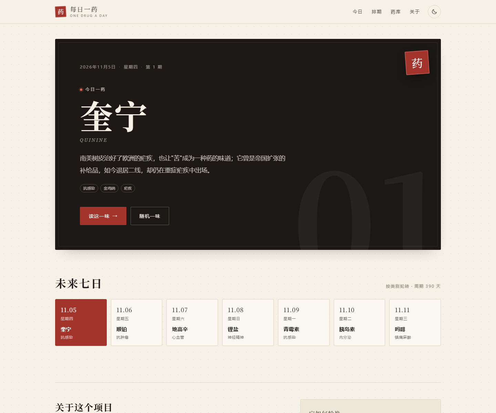
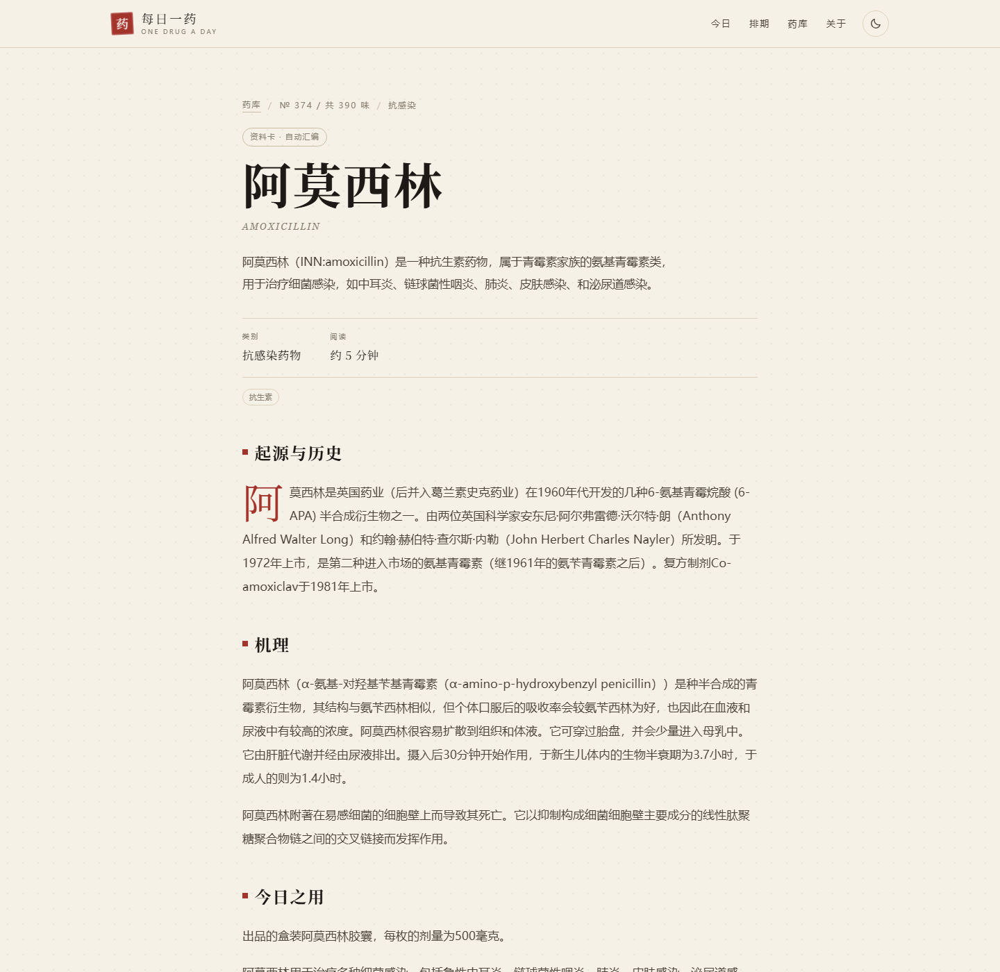
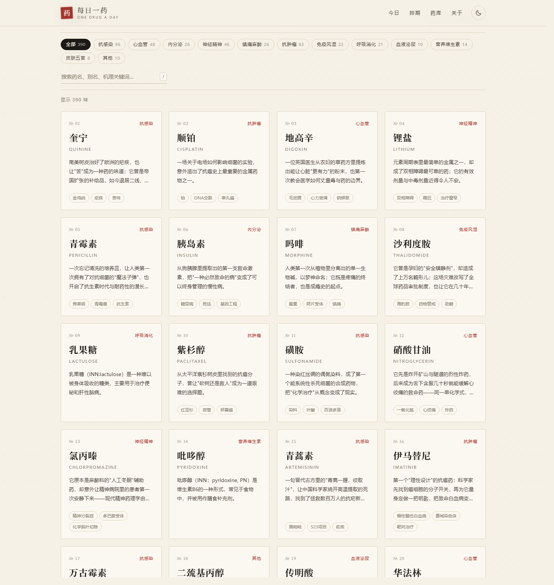

<div align="center">

# 每日一药

**一天认识一味药，一年不重样。**

18 篇手写深读 + 数百张从中文维基百科自动汇编的「资料卡」，按类别均匀轮换；每天 00:05（北京时间）由 GitHub Actions 联网刷新当周条目并重新部署。

[](https://www.python.org/)
[](./build.py)
[](./content/auto)
[](./LICENSE)
[](#许可与来源)

[在线预览](https://hityunong0920-star.github.io/medicine-almanac/) · [快速开始](#快速开始) · [每天怎么更新](#每天怎么更新) · [新增药品](#新增药品) · [部署](#部署到-github-pages)

</div>



<details>
<summary>资料卡页面预览</summary>



</details>

<details>
<summary>药库预览（390 味，按类别筛选）</summary>



</details>

## 这是什么

一个可以每天打开一次的小网站：它从药库里取出"今天的药"，讲清楚这味药从哪里来、在体内如何工作，以及它的边界在哪里。

药库分两层：

| | 深读 | 资料卡 |
| --- | --- | --- |
| 数量 | 18 篇 | 372 张 |
| 来源 | 手写 | 中文维基百科自动汇编 |
| 结构 | 起源 / 经典故事 / 机理 / 今日之用 / 安全边界 / 冷知识 | 起源与历史 / 机理 / 今日之用 / 安全边界 |
| 更新 | 随仓库提交 | GitHub Actions 每天刷新当周条目 |
| 许可 | CC BY-NC-SA 4.0 | CC BY-SA 4.0（保留原文链接） |

按 390 味计算，轮完一遍超过一年；新增药品后周期自动变长。

> 内容仅供科普与学习，不构成医疗建议。处方药请遵医嘱。

## 特性

- **够一年不重样**：749 个药品种子，构建时只保留资料完整、可读的条目，当前生成 372 张资料卡。
- **每天真的会更新**：部署工作流每天 00:05（北京时间）抓取未来 7 天要登场的资料卡，再重新构建；抓取失败也不会影响站点发布（`continue-on-error` + 本地缓存）。
- **零依赖构建**：`build.py` 只用 Python 标准库，不装包、不连 CDN；`dist/` 可直接托管。
- **静态优先**：首页与文章页在构建期预渲染，禁用 JS 也能读；搜索、筛选、深浅色、随机一味是渐进增强。
- **内容分层且诚实**：手写深读写故事，资料卡标注"自动汇编"、原文链接与许可，不冒充原创。
- **按类别均匀轮换**：大类别出现得更频繁，但任何阶段都不会连续几天都是同一类药。

## 快速开始

```bash
git clone https://github.com/hityunong0920-star/medicine-almanac.git
cd medicine-almanac

python build.py
python -m http.server 8000 --directory dist
```

打开 <http://localhost:8000> 即可。仓库里已经带好生成好的资料卡，**不联网也能完整构建**。

构建成功后终端会告诉你今天轮到哪一味：

```text
[OK] 已生成 390 味 -> .../dist
     深读 18 篇 · 资料卡 372 张
     今日 2026-11-05 第 1 期：奎宁
     本地预览：python -m http.server 8000 --directory dist
```

## 目录结构

```text
medicine-almanac/
├─ content/
│  ├─ drugs/              # 手写深读（18 篇）
│  └─ auto/               # 自动汇编的资料卡（已生成，随仓库提交）
├─ tools/
│  ├─ seeds.py            # 749 个药品种子：(英文名, 分类)
│  └─ fetch_wiki.py       # 抓取 + 抽取 + 生成资料卡
├─ site/assets/           # style.css / app.js / theme.js / favicon
├─ build.py               # 零依赖生成器：Markdown -> dist/
├─ data/cache/            # 抓取缓存（gitignore，可重建）
├─ dist/                  # 构建产物（gitignore）
└─ .github/workflows/     # GitHub Pages 部署 + 每日刷新
```

## 两种内容是怎么来的

### 深读

`content/drugs/*.md`，一篇一个药，front matter + Markdown。适合写有故事、有细节的药。

### 资料卡

`content/auto/*.md` 由 `tools/fetch_wiki.py` 生成：

1. 用英文维基的 `langlinks` 批量解析出中文标题；
2. 逐条请求中文维基的 `action=parse`（`variant=zh-cn`，统一简体）；
3. 按二级标题切分，抽取「医疗用途 / 药理·作用机制 / 不良反应 / 历史」；
4. 过滤掉没有安全章节、正文过短的条目，保留原文链接与许可；
5. 写入 `content/auto/<id>.md`，缓存原始响应到 `data/cache/`。

抓取按 40 条/批调用 `Special:Export`，一次全量只需十几次请求；原始 wikitext 缓存到 `data/cache/`，中断后重跑会跳过已缓存的页面。繁简转换使用 [OpenCC](https://github.com/BYVoid/OpenCC) 的 TSCharacters 字典（Apache-2.0）。

## 每天怎么轮换

药库按类别均匀交错排序：每一类在 `[0, 1)` 上均匀铺开，再统一排序。这样大类别出现得更频繁，但不会出现"最后两个月全是抗生素"。

```text
(今天 − 2026-11-05) mod 药库总数
```

- 周期 = 药库总数，轮完一遍从头开始。
- 起始日期在 `build.py` 顶部的 `START_DATE` 修改。
- 日期以 `Asia/Shanghai` 为准，全球同一天看到同一味药。

## 每天怎么更新

`.github/workflows/deploy.yml` 里有一条定时任务：

```yaml
schedule:
  - cron: "5 16 * * *"   # 16:05 UTC = 北京时间次日 00:05
```

它每天：

1. 运行 `python tools/fetch_wiki.py --upcoming 7`，重新抓取未来 7 天要登场的资料卡；
2. 运行 `python build.py`，重新预渲染首页与文章；
3. 发布到 GitHub Pages。

抓取步骤设置了 `continue-on-error: true`——维基限流或网络故障时，站点仍会用上一次的内容正常发布。

本地想手动刷新：

```bash
python tools/fetch_wiki.py --upcoming 7     # 刷新当周
python tools/fetch_wiki.py --ids quinine    # 刷新指定条目
python tools/fetch_wiki.py --all --target 380 --force   # 全量重抓
```

## 新增药品

### 方式 A：写一篇深读（推荐给有故事的药）

1. 复制 `content/drugs/_template.md` 为 `content/drugs/your-drug.md`；
2. 填写 front matter，按六段式写正文；
3. `python build.py` 确认无误后提交。

| 字段 | 必填 | 说明 |
| --- | :---: | --- |
| `id` | ✓ | 小写字母、数字、连字符；决定地址 `drug/<id>.html` |
| `name` | ✓ | 中文药名 |
| `en` | ✓ | 英文名 |
| `alias` | | 别名或商品名 |
| `category` | ✓ | 药库筛选分类 |
| `family` | | 药理类别，显示在详情页 |
| `year` | | 首次发现/上市年份（资料卡可省略） |
| `tags` | | 关键词数组：`[标签一, 标签二]` |
| `summary` | ✓ | 一句话摘要 |

### 方式 B：加一张资料卡

1. 在 `tools/seeds.py` 对应分类下加一行：`("DrugName", "抗感染"),`（英文维基标题）；
2. 运行 `python tools/fetch_wiki.py --all --target 380`（或先 `--limit 20` 试跑）；
3. 构建并提交。

如果中文维基没有对应条目、或条目缺少安全章节，这条会被自动跳过——这是有意的质量门槛。

## 部署到 GitHub Pages

1. 新建仓库，推送到 `main`。
2. **Settings → Pages → Build and deployment → Source** 选 **GitHub Actions**。
3. 之后每次 push 自动发布；也可以在 **Actions** 里手动运行 `Deploy to GitHub Pages`。

站点全部使用相对路径，部署在 `https://<user>.github.io/<repo>/` 下无需改配置。

可选配置（`build.py` 顶部）：

| 变量 | 作用 |
| --- | --- |
| `SITE_NAME` / `SITE_TAGLINE` | 站名与副标题 |
| `REPO_URL` | 填仓库地址后，顶栏出现 GitHub 链接 |
| `START_DATE` | 第 1 期的日期，影响"第几期"与轮换 |
| `CATEGORY_ORDER` | 筛选分类的显示顺序 |

配色集中在 `site/assets/style.css` 顶部的 CSS 变量里。

## 许可与来源

- **代码**：[MIT](LICENSE)
- **手写深读**（`content/drugs/`）：[CC BY-NC-SA 4.0](https://creativecommons.org/licenses/by-nc-sa/4.0/deed.zh)
- **自动资料卡**（`content/auto/`）：汇编自[中文维基百科](https://zh.wikipedia.org/)，遵循 [CC BY-SA 4.0](https://creativecommons.org/licenses/by-sa/4.0/deed.zh)；每张卡片页脚保留条目链接与许可说明。繁简转换使用 [OpenCC](https://github.com/BYVoid/OpenCC)（Apache-2.0）。

维基百科内容可能滞后、缺失或有争议；资料卡只做摘录与结构化，不做医学判断。发现错误欢迎提 Issue 或直接改 `content/auto/` 里的对应文件。

## 已知限制

- 自动汇编没有"经典故事"，可读性不如手写深读；有故事的药建议写成深读。
- 中文维基条目质量参差，短条目会被过滤，所以种子数（749）大于实际卡片数（372）。
- 抓取受网络与维基限流影响；缓存与 `continue-on-error` 保证站点不会因此挂掉。
- 所有剂量、适应症信息仅供科普，不能替代药品说明书与医生判断。

## 免责声明

本站内容仅供科普与学习，不构成任何医疗建议。处方药请在医生或药师指导下使用；出现急症请立即就医。
